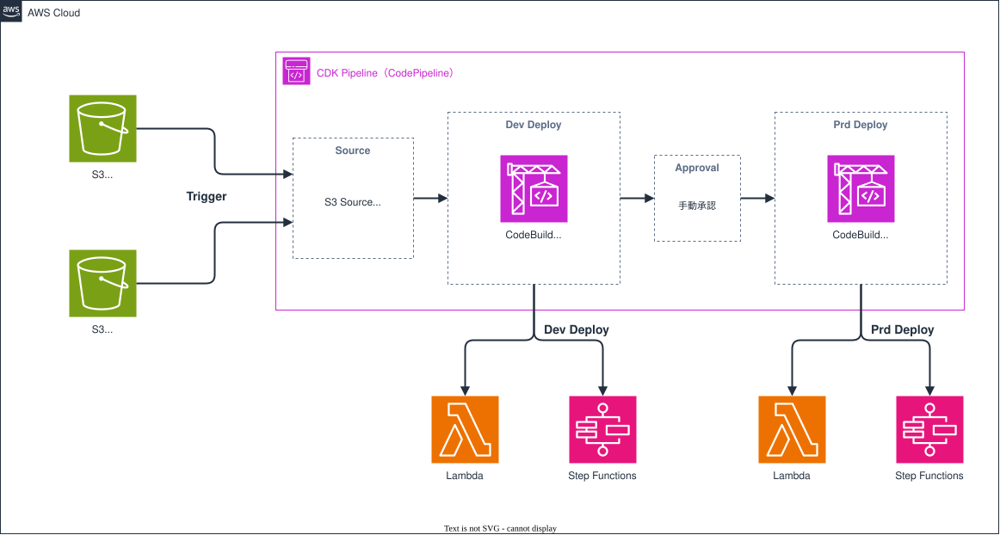

# cdk-pipeline-multi-input-core

## 概要

Lambda や Step Functions など、アプリケーション起因のリソースを構築するための CDK Pipeline です。

インフラ（IaC）とアプリケーションの責任範囲を分けることを目的としています。

- IaC 側の責任範囲: CDK のコードと Pipeline の定義。このリポジトリで管理し、専用の S3 バケットに配置します
- アプリ側の責任範囲: Lambda や Step Functions などのアプリケーションのソース。別リポジトリ（今回は S3）で管理し、zip で配置します

どちらの S3 に配置しても Pipeline が起動するため、IaC 側とアプリ側はそれぞれ独立して変更をデプロイできます。

---

## アーキテクチャ図

